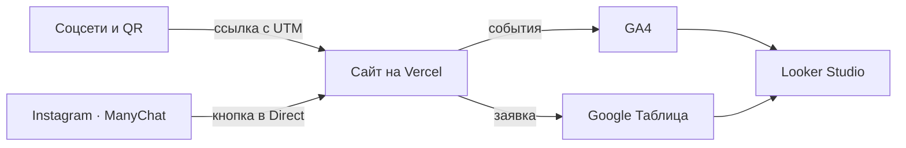

# Описание работы · ТЗ № ТЗ-04/2026 · «Белая линия»

Текст переносится в репозиторий проекта как `docs/opisanie.md`. Кадры ниже — только те файлы, которые уже лежат в `screens/`.

**Исполнитель:** Константинов Валерий Владимирович, группа РПО 25/9/3
**Сайт:** https://white-line-sooty.vercel.app
**Период проверок:** 1–28 октября 2026, публикации Instagram — 29 октября 2026

## 1. Задача заказчика

Компания «Белая линия» принимает около 1 100 пациентов в месяц, из них 210 — новые. Новые пациенты записываются по телефону, через Instagram и ВКонтакте. В сентябре 2026 года в соцсети написали 260 человек, записались 118. Клиника не знает, сколько пришло по рекламе, а сколько по рекомендации. На продвижение уходит 65 000 ₽ в месяц: 45 000 ₽ на соцсети и 20 000 ₽ на листовки. С 1 ноября 2026 года нужна акция «профессиональная гигиена и консультация за 3 900 ₽», сайт с записью и одна таблица, где у каждой заявки есть источник.

## 2. Схема работы

Отдельного файла `docs/scheme.png` в репозитории проекта ещё нет. Путь данных такой:

Посетитель приходит из соцсетей или по QR-коду по ссылке с UTM-метками. Сайт на Vercel отправляет события в GA4, а заявку — в Google Таблицу через Apps Script. Данные GA4 и таблицы собираются в отчёте Looker Studio. HubSpot в цепочку не входит.

## 3. Сайт

Сайт из 8 страниц и `404.html` создан в Cursor и доработан вручную: форма записи, события только в `js/analytics.js`, порядок блоков по приложению А. Опубликован на Vercel, обновляется после push.

Кадров главной и мобильной вёрстки в `screens/kursovaya/` нет. Есть оценка Lighthouse главной в мобильном режиме, 29 октября 2026: Performance 76, Accessibility 95, SEO 100.

Путь на снимке — из репозитория проекта. В этой папке файла нет.

## 4. Аналитика GA4

Настроено 20 событий: 6 собирает расширенная статистика, 14 своих отправляет `js/analytics.js`. Ключевые события: `generate_lead`, `contact_click`, `messenger_click`. Пользовательских определений параметров — 7: `button_name`, `page_section`, `service_name`, `specialty`, `search_term`, `lead_service`, `messenger`. Ресурс `G-7BTPH14B6G`. В коде `debug_mode` выключен. Снимки DebugView с раскрытым параметром лежат в `screens/ga4/`.

Отдельного кадра списка пользовательских определений нет.

## 5. UTM-ссылки и соцсети

В реестре 12 ссылок, `docs/utm.csv`. Опубликованы два поста Instagram от 29 октября 2026. Для ВКонтакте, Telegram и YouTube есть размеченные ссылки, отдельных страниц этих каналов нет. QR для листовки собран (`docs/qr-u-12.png`), ники партнёров `partner_one` и `partner_two` не заменены.

Кадра самого реестра нет. В обработанном отчёте Traffic acquisition за 1–28 октября 2026 три пары источник/канал и 10 сеансов: `(direct) / (none)` — 5, `vercel.com / referral` — 4, `yandex / organic` — 1. Ключевых событий 0.

## 6. Заявки

Форма отправляет заявку в Apps Script. Скрипт проверяет поля, сам ставит `created_at` и статус `new`, повторный `request_id` не пишет второй строкой. За период отчёта в листе `leads` одна заявка: статус `new`, `utm_source` = `direct`, дата 28 октября 2026. Имени, телефона и почты в отчёте нет. Событие `generate_lead` за тот же период в GA4 — 0.

Кадров формы и строки таблицы в `screens/kursovaya/` нет. На странице «Заявки» отчёта видно ту же одну запись.

## 7. Автоответы в Instagram

Комментарий «ЧЕК» под постом гигиены запускает ответ в комментариях и сообщение в Direct с кнопкой «Открыть памятку» на ссылку U-02. Вторая автоматизация — слово «ДЕТИ» под постом детского приёма, кнопка «Детский приём» на ссылку U-03.

Обе автоматизации Live на аккаунте @noearhiviste: `IG · Hygiene Nov 2026 · Reel 01` и `IG · Kids Nov 2026 · Post 01`. 30 октября 2026 со второго аккаунта оба сообщения пришли в Direct, обе кнопки открыли сайт с метками. Кадры: `screens/instagram/dm-both.jpg`, `redirect-hygiene.jpg`, `checkup-open.jpg`, `redirect-kids.jpg`, `kids-open.jpg`. Кадра самого комментария под постом нет.

## 8. Отчёты и дашборд

Воронка «БЕЛАЯ ЛИНИЯ · Воронка» показала наибольшую потерю между `page_view` и `cta_click` (100 %). На `page_view` 4 пользователя, на следующих шагах — 0. Единственная заявка в таблице пришла с источника `direct`. В отчёте Looker Studio три страницы: трафик, заявки, кампании. На странице кампаний конверсия пустая: в GA4 источник записан как `(direct)`, в таблице как `direct`, склейка их не соединила. Отдельного снимка воронки Explore нет.

## 9. Что получил бизнес

| Было | Стало |
|---|---|
| заявки в телефоне, Instagram и ВКонтакте | заявка с сайта пишется в одну таблицу со статусом |
| источник пациента неизвестен | у заявки есть поля source, medium, campaign |
| 65 000 ₽ в месяц без понимания, что окупается | в Looker Studio видны сеансы по каналам и заявки по источнику |
| ответы на комментарии вручную | ManyChat отвечает на «ЧЕК» и «ДЕТИ» и ведёт на сайт |

Рекомендация заказчику: на странице памятки поставить кнопку записи первым видимым действием и снова снять воронку. Сейчас между `page_view` и `cta_click` теряется 100 %. Переносить 45 000 ₽ между каналами по этим данным рано: в обработанном отчёте одна заявка, и она не подтверждена `generate_lead`.

## 10. Итог

Не получилось: отдельные страницы ВКонтакте, Telegram и YouTube; страница Instagram `belaya_liniya_dent`; разные сообщения на одном посте; кадр самого комментария под постом; замена ников партнёров; доступ Viewer в GA4 по почте; HubSpot. Таблица и Looker Studio открыты всем, у кого есть ссылка, с правом читателя.

ИИ использовался для: структуры сайта, текстов, вёрстки, портретов врачей, PDF, QR и журнала запросов в `docs/prompts.md`.
