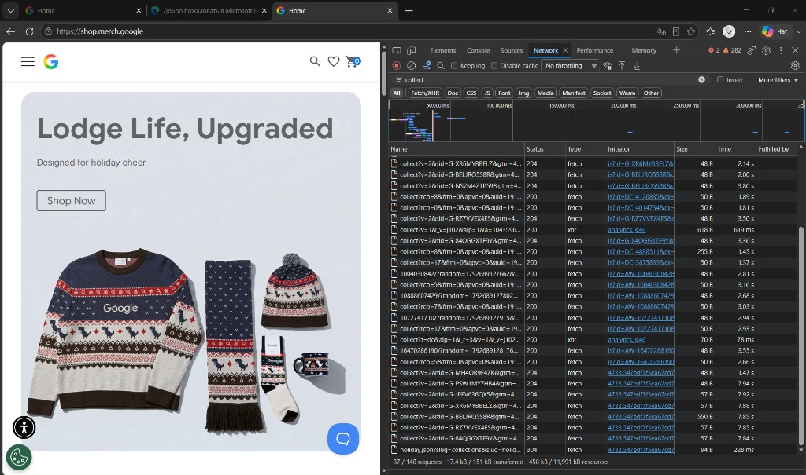
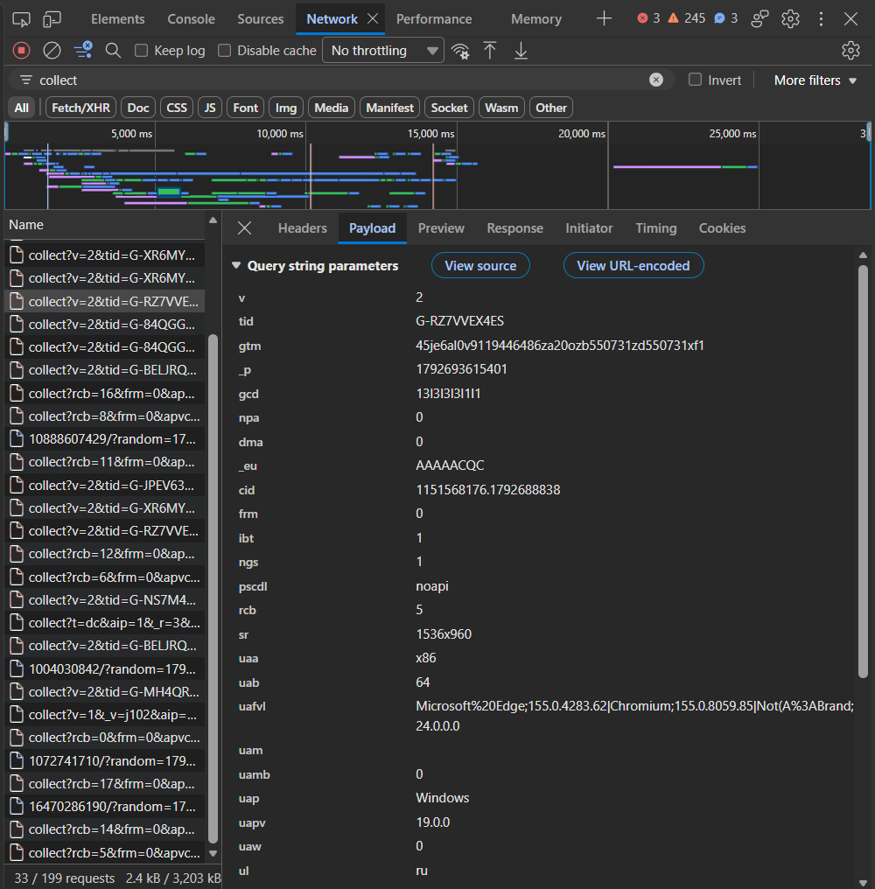

# Домашняя работа № 1 · Путь данных от ссылки до заявки

**Дисциплина:** ОП.03 «Информационные технологии»

| Поле | Значение |
|---|---|
| Фамилия, имя, отчество | Константинов Валерий Владимирович |
| Группа | РПО 25/9/3 |
| Номер работы | 1 |
| Тема работы | Цифровая воронка: путь данных от ссылки до заявки |
| Дата сдачи | 25.09.26 |
| Ветка | `hw-01` |

---

## Задание

1. Открыть сайт, панель разработчика (F12) → **Network**, в фильтре `collect`,
   галочка **Preserve log**.
2. Сделать три действия: обновить страницу, прокрутить до низа, нажать
   на товар. Записать, какие события ушли — параметр `en` на вкладке **Payload**.
3. Описать путь пользователя от ссылки до заявки, пять шагов.
4. Найти одно место на этом пути, где данные могут потеряться.
5. Приложить скриншоты `screens/01-network.png` и `screens/02-payload.png`.

Сайт: https://shop.merch.google/, запасные — https://habr.com/ru/,
https://www.smashingmagazine.com/, https://css-tricks.com/. Открывать
в Chrome или Edge с выключенным блокировщиком рекламы.

Срок — до начала занятия 2. Ветка `hw-01`, запрос на слияние в свою `main`.

---

## 1. Какой сайт смотрел

| Поле | Значение |
|---|---|
| Название сайта | Google Merchandise Store |
| Адрес | https://shop.merch.google/ |
| Откуда сайт | из задания |

## 2. Три действия и что отправил счётчик

Панель Network, фильтр `collect`, галочка Preserve log. Название события
лежит в параметре `en` на вкладке Payload.

| № | Что я сделал на сайте | Название события (`en`) | Что ещё было в Payload |
|---|---|---|---|
| 1 | обновил главную страницу | `page_view` | `dl` — адрес открытой страницы, `dt` — заголовок вкладки |
| 2 | прокрутил страницу до низа | `scroll` | `epn.percent_scrolled` = `90` |
| 3 | нажал на карточку товара | `select_item` | в Payload уходит выбранный товар: его название и идентификатор позиции |

Если на кадре Payload у третьего запроса в `en` стоит не `select_item`, а другое имя, в таблицу записывается имя с кадра. Часто рядом приходит ещё `view_item`, когда открылась страница товара: в работу берётся то событие, которое видно на приложенном кадре.

## 3. Путь пользователя: 5 шагов

| № | Мой шаг | Пример |
|---|---|---|
| 1 | Человек получил ссылку на магазин и открыл её | *человек увидел ссылку и нажал на неё* |
| 2 | Открылась главная страница магазина | *открылась главная страница сайта* |
| 3 | Он нажал на товар и открыл карточку | *он прокрутил до формы записи* |
| 4 | Положил товар в корзину и перешёл к оформлению | *начал заполнять: имя и телефон* |
| 5 | Подтвердил заказ | *нажал «Отправить», заявка ушла менеджеру* |

Для магазина целевое действие — заказ, а не заявка на курсы. Пять шагов выше ведут от ссылки до этого заказа.

## 4. Где данные могут потеряться

| № | На каком шаге | Что может потеряться |
|---|---|---|
| 1 | шаг 5, подтверждение заказа | человек дошёл до оформления и закрыл вкладку. Событие заказа не ушло запросом `collect`, в аналитике остаётся просмотр товара, а заказа нет |
| 2 | шаг 1, первый заход | блокировщик рекламы обрывает запрос `collect`. Счётчик не получает `page_view`, и весь визит для аналитики пропадает |

## 5. Использование ИИ

| Вопрос | Ответ |
|---|---|
| Что сделал сам | открыл магазин, снял панель Network и вкладку Payload, сверил параметр `en` с таблицей |
| Что спросил у модели | формулировки бланка |
| Что после этого изменил | |
