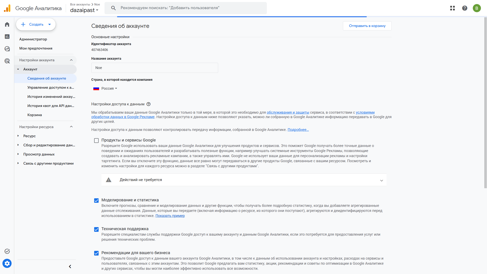
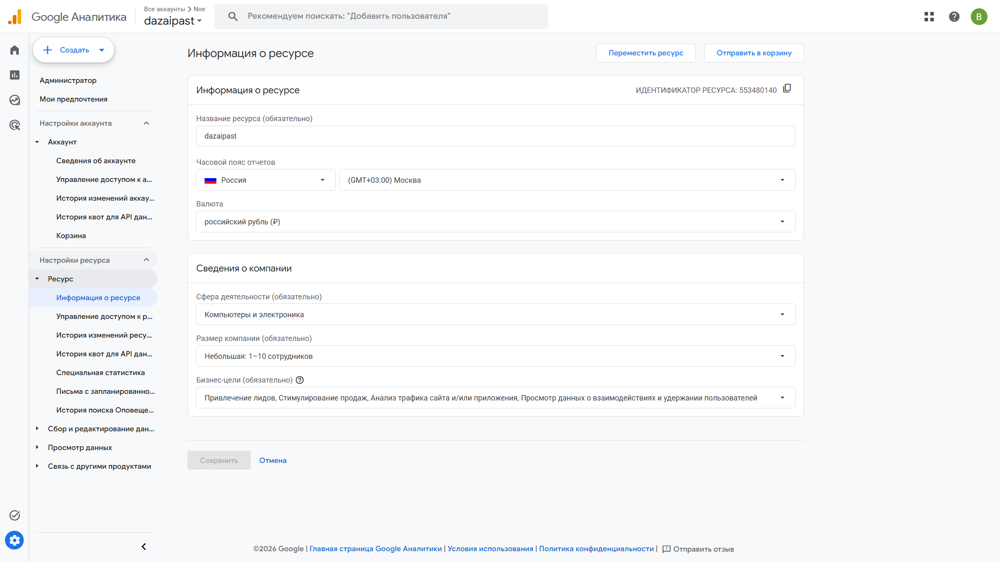
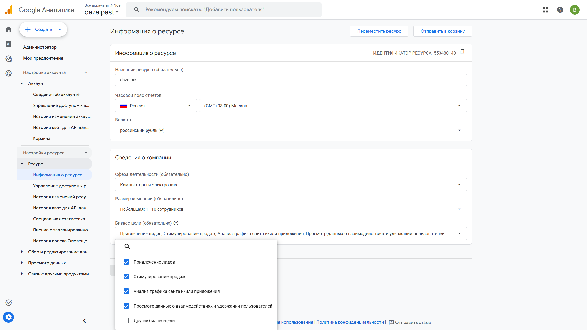
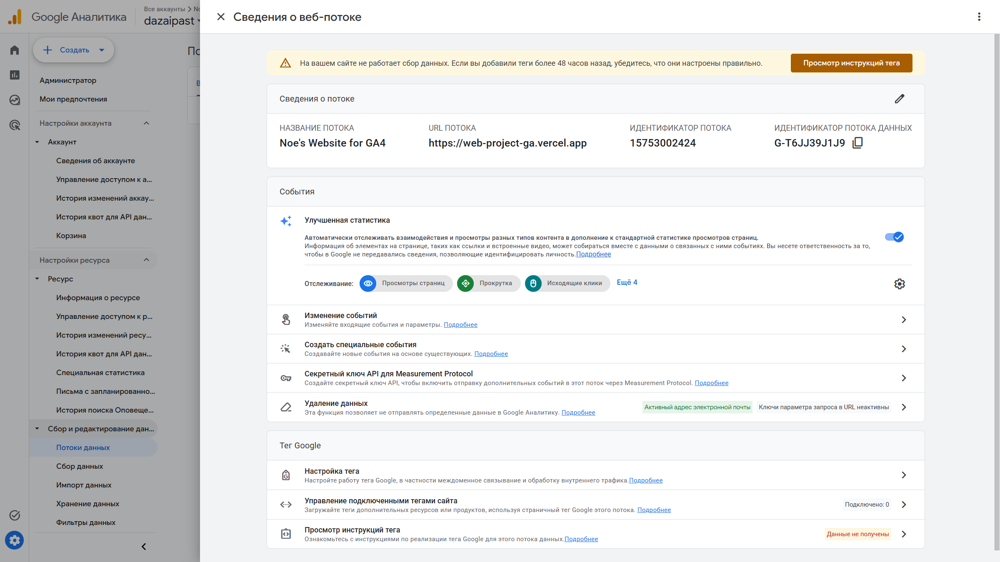

# Домашняя работа № 2 · Где бизнес теряет клиентов

**Дисциплина:** ОП.03 «Информационные технологии»

| Поле | Значение |
|---|---|
| Фамилия, имя, отчество | Константинов Валерий Владимирович |
| Группа | РПО 25/9/3 |
| Номер работы | 2 |
| Тема работы | Анализ воронки цифрового продукта и структура Google Analytics 4 |
| Дата сдачи | 25.09.26 |
| Ветка | `hw-02` |

---

# Часть 1. Исследование воронки

## 1.1. Объект исследования

| Поле | Значение |
|---|---|
| Компания, сервис или отрасль | Lamoda, интернет-магазин одежды, обуви и аксессуаров |
| Адрес сайта или приложения | https://www.lamoda.ru/ |
| Целевое действие | выкуп: покупатель не только оформил заказ, но и забрал товар |
| Почему выбран этот объект | у продавца в Lamoda есть отчёт «Воронка продаж» с шагами просмотр, корзина, заказ и выкуп. По этому пути видно, где магазин теряет покупателя. Сама Lamoda публикует A/B-тесты по этим же переходам |

## 1.2. Воронка

| № | Этап | Что считается переходом дальше | Метрика этапа |
|---|---|---|---|
| 1 | Показ и переход на карточку | человек открыл карточку товара | просмотры карточки |
| 2 | Добавление в корзину | товар попал в корзину | конверсия из просмотра в корзину, число добавлений |
| 3 | Оформление заказа | покупатель подтвердил заказ | конверсия из корзины в заказ, число заказов |
| 4 | Выкуп | покупатель забрал товар, а не отказался при примерке | процент выкупа, число выкупов |
| 5 | Возврат | товар вернулся продавцу после выкупа | процент возвратов |

## 1.3. Источники

### Источник 1

| Поле | Значение |
|---|---|
| Название материала | Отчет «Воронка продаж» |
| Автор или организация | Lamoda Academy |
| Дата публикации | обновлено 23.03.2026 |
| Прямая ссылка | https://academy.lamoda.ru/articles/lamoda-analytics-board/analitika-v-lk/otchet-voronka-prodazh/ |

**Выписка из материала** (ключевая мысль, цифра, наблюдение, результат):

> «Отчет „Воронка продаж“ — это базовый инструмент для понимания, как покупатели проходят путь от просмотра товара до выкупа.» График показывает просмотры, корзину, заказы и выкупы. Если просмотров много, а добавлений в корзину мало, Lamoda считает, что проблема в карточке или цене. Если корзин много, а заказов мало, покупатель сомневается. Отдельный сигнал: «Заказы растут, а выкупы — нет».

**Что подтверждает и как связано с моей воронкой** (своими словами):

> Источник задаёт те же этапы, что я взял для Lamoda: просмотр, корзина, заказ, выкуп. Потеря бывает не только в конце. Для каждого перехода в отчёте есть своя проверка.

**Цифры из источника и этап воронки, к которому относятся:**

> Точные проценты конверсии магазина статья не приводит. К этапам 1–4 относятся названия шагов отчёта: просмотры, корзина, заказы, выкупы. К этапу 5 — процент возвратов.

### Источник 2

| Поле | Значение |
|---|---|
| Название материала | Big Data в моде: как мы внедрили 1-to-1 персонализацию в каталоге и поиске |
| Автор или организация | Сергей Евстафьев и Дана Злочевская, Lamoda Tech, публикация на Хабре |
| Дата публикации | 3 сентября 2024 |
| Прямая ссылка | https://habr.com/ru/companies/lamoda/articles/840370/ |

**Выписка из материала:**

> «В каталоге Lamoda в наличии более полумиллиона модных товаров, однако 95% пользователей не просматривают больше первых 120 карточек.» Первый A/B-тест переранжирования 150 кандидатов: «прокрасилась вся воронка. То есть пользователи начали чаще кликать, чаще добавлять в корзину, чаще делать покупки.» «По метрикам мы получили +2% NMV и +1.7% к конверсии в выкуп.» Следующий тест, уже на 300 кандидатах и с поиском, дал ещё +1.3% NMV.

**Что подтверждает и как связано с моей воронкой:**

> Большая часть людей не листает каталог глубоко, поэтому потеря начинается ещё на показе: нерелевантная карточка в первых рядах не получает клик. Когда выдачу перестроили, выросли и клики, и корзина, и выкуп. Это этапы 1, 2 и 4 моей воронки.

**Цифры из источника и этап воронки:**

> 95% пользователей не смотрят больше первых 120 карточек — этап 1, показ. +2% NMV и +1.7% к конверсии в выкуп — этапы от клика до выкупа, явно назван выкуп, этап 4. Дополнительные +1.3% NMV — тот же участок после расширения персонализации на поиск.

### Источник 3

| Поле | Значение |
|---|---|
| Название материала | Как за год вырастить персонализацию на главной: эволюция рекомендаций в fashion ecom |
| Автор или организация | Lamoda, публикация на Хабре |
| Дата публикации | 2025, в тексте описаны тесты с весны 2024 года |
| Прямая ссылка | https://habr.com/ru/companies/lamoda/articles/943272/ |

**Выписка из материала:**

> Весной 2024 года на главной запустили виджет рекомендаций. В первом A/B-тесте целевая метрика, покупки, не прокрасилась, но конверсия добавления в корзину выросла на 0,3%. Тест новой главной против старой дал +1,2% к конверсии добавления в корзину и +1,1% к конверсии в покупку. Реранкер затем дал +0,7% к корзине и +1% к покупке.

**Что подтверждает и как связано с моей воронкой:**

> Главная — первая точка после перехода по ссылке. Если подборка слабая, человек не доходит до карточки и корзины. Рост корзины без роста покупок в первом тесте показывает, что этапы 2 и 3 двигаются не всегда вместе.

**Цифры из источника и этап воронки:**

> +0,3%, +1,2% и +0,7% — конверсия добавления в корзину, этап 2. +1,1% и +1% — конверсия в покупку, переход к этапам 3–4. Точный процент выкупа в этой статье не приведён.

### Источник 4

| Поле | Значение |
|---|---|
| Название материала | Как новые бейджи помогли изменить пользовательский опыт — кейс Lamoda |
| Автор или организация | Полина Орлова, менеджер продукта Lamoda, публикация на vc.ru |
| Дата публикации | страница кейса на vc.ru |
| Прямая ссылка | https://vc.ru/growth/1132734-kak-novye-beidzhi-pomogli-izmenit-polzovatelskii-opyt-keis-lamoda |

**Выписка из материала:**

> «Уже в начале тестового периода конверсия в заказ потенциально выросла на 0,2%, а конверсия в повторный заказ — на 0,65%.» В A/B-тесте тестовая группа чаще кликала по релевантным карточкам, конверсия в корзину и последующий заказ тоже выросла.

**Что подтверждает и как связано с моей воронкой:**

> Бейдж на карточке в каталоге меняет клик и корзину, то есть этапы 1–2, и следом заказ, этап 3. Повторный заказ — это уже следующий виток той же воронки.

**Цифры из источника и этап воронки:**

> +0,2% — конверсия в заказ, этап 3. +0,65% — конверсия в повторный заказ, тот же этап на следующем визите. Точный прирост корзины в процентах в открытом тексте не выделен отдельным числом.

### Источник 5

| Поле | Значение |
|---|---|
| Название материала | Интернет-торговля в России 2025 |
| Автор или организация | Data Insight |
| Дата публикации | 19 мая 2025 |
| Прямая ссылка | https://datainsight.ru/DI_eCommerce_2025 |

**Выписка из материала:**

> «В 2024 году объем рынка розничной интернет-торговли в России составил 11,2 трлн рублей и 6,8 млрд заказов.» «Средний чек продолжает постепенно снижаться: по итогам 2024 года он составляет 1 650 рублей, что на 4% ниже прошлогодних показателей.» Во второй половине 2024 года доля Wildberries и Ozon в числе заказов — 56% и 21%.

**Что подтверждает и как связано с моей воронкой:**

> Покупатель сравнивает цену с маркетплейсами. Если на Lamoda итоговая цена на шаге заказа хуже, человек уходит в корзину Wildberries или Ozon. Падение среднего чека бьёт по этапу оформления: человек доходит до цены и останавливается.

**Цифры из источника и этап воронки:**

> 11,2 трлн рублей и 6,8 млрд заказов за 2024 год — масштаб этапа «заказ» по всему рынку, не конверсия Lamoda. Средний чек 1 650 рублей, минус 4% к прошлому году — этап 3, где покупатель видит итоговую цену. Доли 56% и 21% — куда уходит заказ, если свой магазин проигрывает на этом шаге.

## 1.4. Реальные кейсы

### Кейс 1

| № | Пункт | Ответ |
|---|---|---|
| 1 | Компания, продукт или рынок | Lamoda, персональное ранжирование каталога и поиска |
| 2 | Как выглядела воронка или её проблемный участок | показ в каталоге → клик по карточке → корзина → покупка → выкуп. 95% людей не смотрят больше первых 120 карточек |
| 3 | В чём заключалась проблема | в топе выдачи оказывались не самые подходящие товары, поэтому клик, корзина и выкуп страдали ещё на показе |
| 4 | Какие данные или наблюдения подтвердили проблему | A/B-тест: после переранжирования прокрасилась вся воронка, люди чаще кликали, клали в корзину и покупали |
| 5 | Что изменили или протестировали | сервис переранжирования топа: сначала 150 кандидатов, затем 300 и поисковые запросы, модель стали переобучать каждый день |
| 6 | Как изменился результат | первый тест: +2% NMV и +1,7% к конверсии в выкуп. Расширение на поиск и 300 кандидатов: ещё +1,3% NMV |
| 7 | Переносим ли подход на мой объект | это и есть мой объект. Для карточки товара вывод тот же: в первых позициях должны быть размер, цена и фото, иначе человек не дойдёт до корзины |

**Ссылка на источник кейса:**

> https://habr.com/ru/companies/lamoda/articles/840370/

### Кейс 2

| № | Пункт | Ответ |
|---|---|---|
| 1 | Компания, продукт или рынок | Lamoda, новые бейджи в каталоге |
| 2 | Как выглядела воронка или её проблемный участок | каталог → клик по карточке → корзина → заказ. На карточке не было короткого сигнала, почему товар подходит |
| 3 | В чём заключалась проблема | покупатель не отличал релевантную карточку от соседней и реже кликал |
| 4 | Какие данные или наблюдения подтвердили проблему | A/B-тест: тестовая группа чаще кликала по подходящим карточкам, росли корзина и заказ |
| 5 | Что изменили или протестировали | новую систему бейджей в каталоге |
| 6 | Как изменился результат | в начале теста конверсия в заказ потенциально выросла на 0,2%, конверсия в повторный заказ — на 0,65% |
| 7 | Переносим ли подход на мой объект | да, на этап карточки Lamoda: короткий знак на карточке проверяется тем же A/B, что и бейджи, по клику, корзине и заказу |

**Ссылка на источник кейса:**

> https://vc.ru/growth/1132734-kak-novye-beidzhi-pomogli-izmenit-polzovatelskii-opyt-keis-lamoda

## 1.5. Причины потери пользователей

| № | Этап воронки | Причина потери | Какой источник это подтверждает |
|---|---|---|---|
| 1 | показ → карточка | человек видит только начало выдачи, и нерелевантный топ не получает клик | Хабр Lamoda: 95% не смотрят больше 120 карточек, https://habr.com/ru/companies/lamoda/articles/840370/ |
| 2 | корзина → заказ | на итоговой цене покупатель сравнивает магазин с Wildberries и Ozon и уходит | Data Insight: средний чек 1 650 рублей, минус 4%, доли маркетплейсов 56% и 21%, https://datainsight.ru/DI_eCommerce_2025 |
| 3 | заказ → выкуп | заказ есть, а ожидания от размера или описания не совпали, выкуп не растёт | отчёт Lamoda: сигнал «Есть заказы, но мало выкупов» и «Заказы растут, а выкупы — нет», https://academy.lamoda.ru/articles/lamoda-analytics-board/analitika-v-lk/otchet-voronka-prodazh/ |

## 1.6. Гипотезы улучшения

| № | Этап | Гипотеза | Какие данные нужно собрать | Как проверить, сработало |
|---|---|---|---|---|
| 1 | просмотр → корзина | если на карточке рядом с ценой показать наличие размера и срок доставки, доля добавлений в корзину вырастет | просмотры карточки и добавления в корзину по одним и тем же товарам | сравнить конверсию в корзину за одинаковый период до и после, на части товаров оставить старую карточку |
| 2 | корзина → заказ | одно письмо о брошенной корзине в день ухода вернёт часть людей к заказу лучше, чем тишина | число брошенных корзин, открытия письма, заказы из этой цепочки | посчитать долю заказов из корзин с письмом и без него за две недели |
| 3 | заказ → выкуп | если в карточке крупнее показать размерную сетку и фото на человеке, процент выкупа вырастет, а возвраты снизятся | заказы, выкупы и возвраты по товарам, где сетку уже поменяли, и по тем, где нет | сравнить процент выкупа этих двух групп за следующий месяц |

---

# Часть 2. Google Analytics 4

## 2.1. Пройденные шаги

| № | Шаг | Выполнено |
|---|---|---|
| 1 | Вход в Google Analytics под своим аккаунтом | да |
| 2 | Создан Analytics Account | да |
| 3 | Создан Property | да |
| 4 | Выбраны часовой пояс, валюта и общие сведения | да |
| 5 | Выбраны бизнес-цели | да |
| 6 | Создан ресурс | да |
| 7 | Создан Web Data Stream | да |
| 8 | Проверены Website URL, Stream name, Enhanced Measurement | да |
| 9 | Поток создан | да |
| 10 | Найден Measurement ID | да |

## 2.2. Что получилось

| Поле | Значение |
|---|---|
| Analytics Account | Noe |
| Property | dazaipast |
| Reporting time zone | (GMT+03:00) Москва, Россия |
| Currency | российский рубль (₽) |
| Выбранные бизнес-цели | привлечение лидов; стимулирование продаж; анализ трафика сайта и/или приложения; просмотр данных о взаимодействиях и удержании пользователей |
| Stream name | Noe's Website for GA4 |
| Website URL | https://web-project-ga.vercel.app |
| Stream ID (числовой) | 15753002424 |
| Measurement ID (`G-…`) | G-T6JJ39J1J9 |
| Enhanced Measurement | включено |

Идентификатор ресурса: 553480140. Сфера на карточке сравнения в отчётах: компьютеры и электроника.

## 2.3. Скриншоты

---

## Использование ИИ

| Вопрос | Ответ |
|---|---|
| Что сделано самостоятельно | выбрал Lamoda, открыл отчёт воронки, статьи Хабра, кейс на vc.ru и сводку Data Insight, собрал этапы и снял кадры GA4 |
| Что спрошено у модели | структуру бланка и формулировки |
| Что после этого проверено и изменено | цифры и цитаты сверены со страницами по ссылкам выше, кадры GA4 сняты со своего ресурса |
