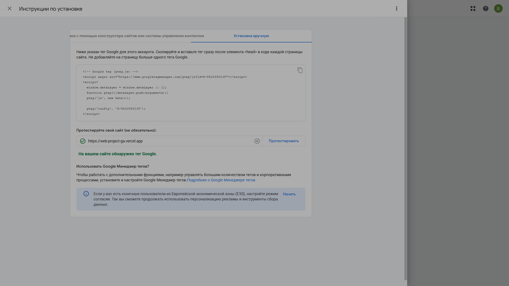
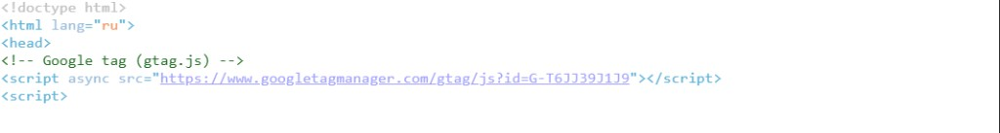
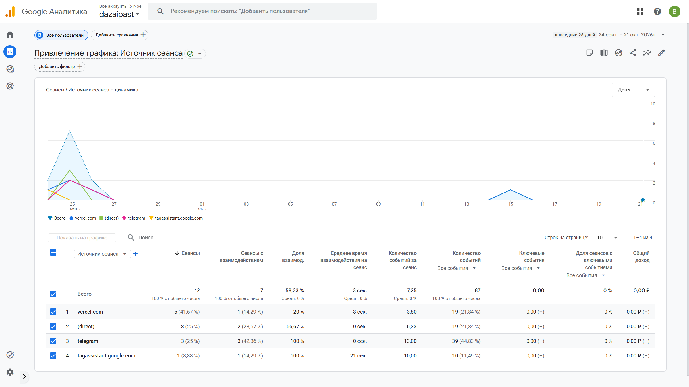
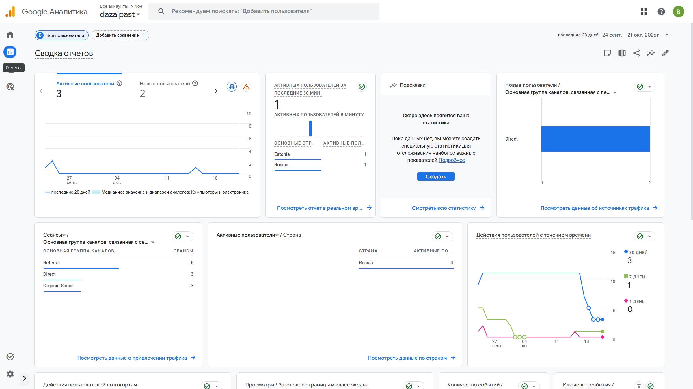

# Домашняя работа № 3 · Тег на сайте, источник и отчёты GA4

**Дисциплина:** ОП.03 «Информационные технологии»

| Поле | Значение |
|---|---|
| Фамилия, имя, отчество | Константинов Валерий Владимирович |
| Группа | РПО 25/9/3 |
| Номер работы | 3 |
| Тема работы | Установка Google Tag, источник перехода и отчёты GA4 |
| Дата сдачи | 25.09.26 |
| Ветка | `hw-03` |

---

## 1. Мой сайт и мой ресурс

| Поле | Значение |
|---|---|
| Адрес репозитория сайта | https://github.com/dazaipast/web-project-GA |
| Публичный адрес сайта | https://web-project-ga.vercel.app/ |
| Статус публикации | READY |
| Analytics Account | Noe |
| Property | dazaipast |
| Stream name | Noe's Website for GA4 |
| Website URL в потоке | https://web-project-ga.vercel.app |
| Measurement ID (`G-…`) | G-T6JJ39J1J9 |
| Страницы с тегом | `index.html`, `about.html`, `contacts.html` |

Тег стоит на каждой странице один раз, сразу после открывающего `<head>`.

## 2. Тег установлен

**Результат проверки из инструкции тега:**

> В коде трёх страниц один тег `G-T6JJ39J1J9`. В карточке потока сбор данных идёт, за последние 48 часов есть трафик. Кадр мастера установки должен показать фразу «На вашем сайте обнаружен тег Google» для адреса https://web-project-ga.vercel.app/.





## 3. События доходят до аналитики

| Поле | Значение |
|---|---|
| Дата и время проверки | 25.09.2026, около 23:42 (МСК) |
| Какие страницы открывали | Home, About, Contacts |
| Какие события появились в Realtime | `page_view` — 7, `scroll` — 7, `form_error` — 4, `nav_click` — 4, `read_30s` — 4, `utm_visit` — 2 |
| Число активных пользователей в момент проверки | 1 за последние 30 минут и 1 за последние 5 минут |

Просмотры в том же отчёте: Home — GA4 Lab — 4, Contacts — GA4 Lab — 2, About — GA4 Lab — 1.


## 4. Источник перехода определился

Ссылка собирается с метками `utm_source`, `utm_medium`, `utm_campaign`
и открывается на своём сайте.

**Ссылка целиком:**

```
https://web-project-ga.vercel.app/?utm_source=telegram&utm_medium=social&utm_campaign=ga4_lab
```

| Поле | Значение |
|---|---|
| Где в GA4 виден источник | Отчёты → Привлечение трафика, измерение «Источник сеанса», период 28 августа – 24 сентября 2026 |
| Какое значение источника показал GA4 | `(direct)`, `vercel.com`, `tagassistant.google.com`. В группах каналов это Direct — 8 сеансов и Referral — 6 сеансов |
| Совпадает с `utm_source` из ссылки | нет |

Переход с `utm_source=telegram` сделан 25.09.2026. Отчёт за 28 августа – 24 сентября этот день не включает, поэтому строки `telegram` в нём нет. Метки при этом дошли до события: в DebugView у `utm_visit` параметр `utm_source` равен `telegram`, `utm_medium` — `social`, `utm_campaign` — `ga4_lab`.



## 5. Статистика на странице «Отчёты»

| Показатель | Значение | Период |
|---|---|---|
| Пользователи | 9 активных, из них 9 новых | 28 августа – 24 сентября 2026 |
| Сеансы | 14 | 28 августа – 24 сентября 2026 |
| События | 159 | 28 августа – 24 сентября 2026 |
| Самое частое событие | `page_view` — 55 | 28 августа – 24 сентября 2026 |



**Что видно по этим числам** (2–3 предложения):

> За 28 дней было 9 пользователей, 14 сеансов и 159 событий. Сеансы делятся на Direct (8) и Referral (6). Чаще всего уходило событие `page_view`. В момент живой проверки на сайте был один пользователь, и в Realtime уже были и просмотры, и свои события `nav_click`, `form_error`, `read_30s`, `utm_visit`.

## 6. Что не получилось

В обработанном отчёте «Привлечение трафика» за 28 августа – 24 сентября 2026 источник `telegram` не появился: период заканчивается накануне перехода по размеченной ссылке. В Realtime карточка первого источника в ту же проверку была пустой. Сами метки видны в параметрах события `utm_visit` в DebugView.

## 7. Использование ИИ

| Вопрос | Ответ |
|---|---|
| Что сделано самостоятельно | поставил тег на три страницы, открыл сайт, сверил Measurement ID и снял Realtime и отчёты |
| Что спрошено у модели | формулировки бланка |
| Что после этого изменено | числа в таблицах берутся с кадров, а не из черновика |
