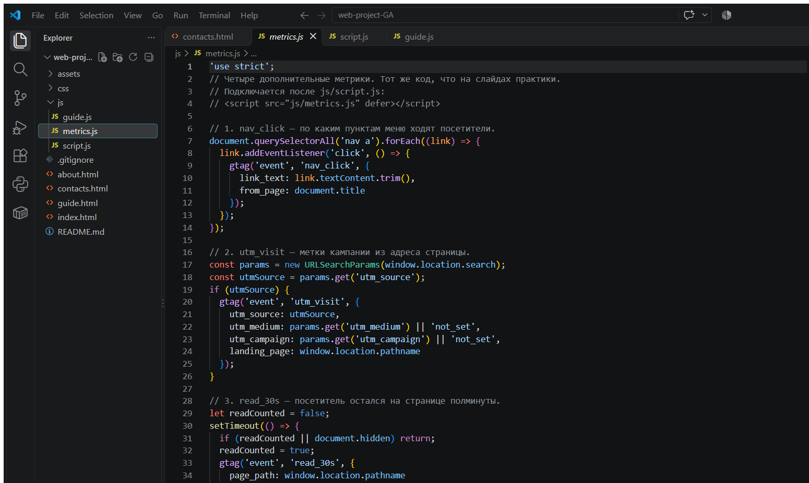
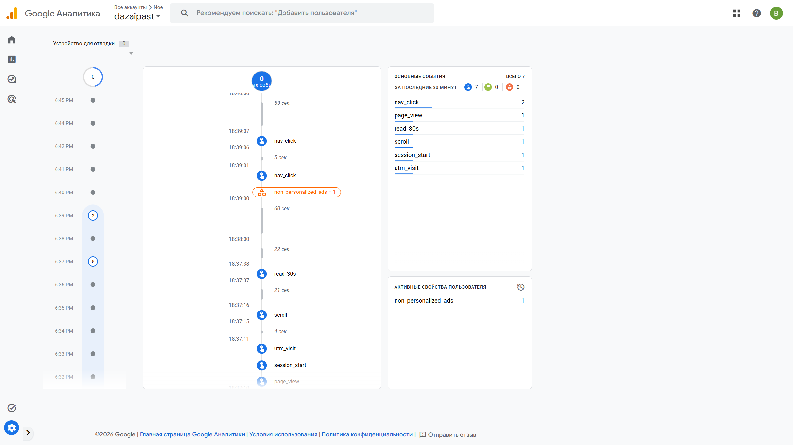
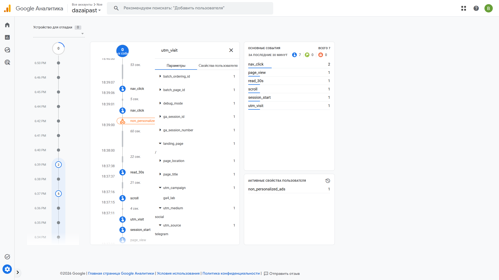
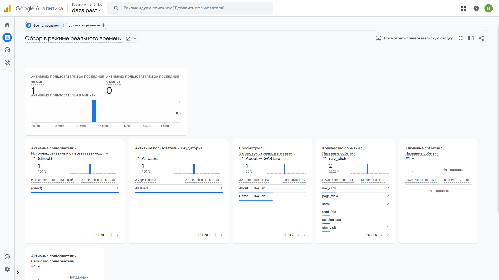

# Домашняя работа № 4 · Свои события и параметры в GA4

**Дисциплина:** ОП.03 «Информационные технологии»

| Поле | Значение |
|---|---|
| Фамилия, имя, отчество | Константинов Валерий Владимирович |
| Группа | РПО 25/9/3 |
| Номер работы | 4 |
| Тема работы | Свои события и параметры: четыре метрики на сайте |
| Дата сдачи | 25.09.26 |
| Ветка | `hw-04` |

---

## 1. Мой сайт и мой ресурс

| Поле | Значение |
|---|---|
| Публичный адрес сайта | https://web-project-ga.vercel.app/ |
| Measurement ID (`G-…`) | G-T6JJ39J1J9 |
| Коммит с метриками (ссылка или первые 7 символов) | `e449638` — https://github.com/dazaipast/web-project-GA/commit/e4496385b684debd538797b57dba7984e67d5704 |
| Статус публикации | READY |
| Страницы, где подключён `js/metrics.js` | `index.html`, `about.html`, `contacts.html` |

Файл подключён один раз на страницу, сразу после `js/script.js`. Отладка DebugView включается параметром адреса `debug_mode=1`: без него обычные визиты в ленту отладки не попадают.

## 2. Какие метрики добавлены

| Событие | Что измеряет | Что делали, чтобы оно сработало |
|---|---|---|
| `nav_click` | клики по пунктам меню | нажал пункт меню About или Contacts |
| `utm_visit` | метки кампании из адреса | открыл сайт по ссылке с `utm_source`, `utm_medium` и `utm_campaign` |
| `read_30s` | полминуты на странице | остался на вкладке 30 секунд и не сворачивал её |
| `form_error` | форма не прошла проверку браузера | на Contacts нажал «Отправить заявку» с пустыми полями имени и email |



## 3. События в DebugView

| Поле | Значение |
|---|---|
| Дата и время проверки | 25.09.2026, около 23:38 (МСК) |
| Как подключали отладку | `debug_mode=1` в адресе страницы |
| Какие из четырёх событий пришли | `nav_click`, `form_error`, `utm_visit`, `read_30s` |
| Какие не пришли и почему | все четыре пришли |

В ленте за ту же минуту рядом были ещё `page_view` и `scroll`. Счётчик за 30 минут на экране DebugView: `nav_click` — 4, `form_error` — 2, `utm_visit` — 2, `read_30s` — 1.



## 4. Параметры события `utm_visit`

**Ссылка, по которой открывали сайт:**

```
https://web-project-ga.vercel.app/?utm_source=telegram&utm_medium=social&utm_campaign=ga4_lab&debug_mode=1
```

| Параметр | Значение в ссылке | Значение в GA4 |
|---|---|---|
| `utm_source` | telegram | telegram |
| `utm_medium` | social | social |
| `utm_campaign` | ga4_lab | ga4_lab |
| `landing_page` | — | `/` на главной; на Contacts было `/contacts.html` |

Значения меток в GA4 совпали со ссылкой. `landing_page` зависит от страницы, которую открыли: для главной это `/`, для страницы контактов — `/contacts.html`. `debug_mode` в адрес добавлен только чтобы событие попало в DebugView, к меткам кампании он не относится.



## 5. Событие вне отладки

| Поле | Значение |
|---|---|
| Где проверяли | Realtime, карточка «Количество событий / Название события» |
| Какое событие искали | `nav_click`, `utm_visit`, `read_30s`, `form_error` |
| Сколько срабатываний показал экран | `nav_click` — 4, `form_error` — 4, `read_30s` — 4, `utm_visit` — 2 |
| Период (для отчёта) | последние 30 минут, проверка 25.09.2026 около 23:42 (МСК) |

На том же экране были `page_view` — 7 и `scroll` — 7. Активный пользователь за 30 минут — 1.



## 6. Что эти метрики показывают про сайт

За эту проверку чаще открывали Home, чем About и Contacts. Клики по меню доходят отдельным событием `nav_click`. Пустая отправка формы на Contacts даёт `form_error`, то есть человек может нажать кнопку, не заполнив имя и email. Размеченный заход с `utm_source=telegram` фиксируется событием `utm_visit`, а `read_30s` показывает, что вкладку хотя бы раз не закрыли полминуты.

## 7. Что не получилось

Все четыре события дошли до DebugView и до Realtime. В отчёте «События» за прошлые сутки этих имён ещё не было: туда данные попадают с задержкой, в день настройки их смотрят в Realtime.

## 8. Использование ИИ

| Вопрос | Ответ |
|---|---|
| Что сделано самостоятельно | подключил готовый `js/metrics.js`, опубликовал сайт, открыл размеченную ссылку и снял DebugView и Realtime |
| Что спрошено у модели | формулировки бланка |
| Что после этого изменено | параметры в таблице сверены с раскрытым событием `utm_visit` на кадре |
