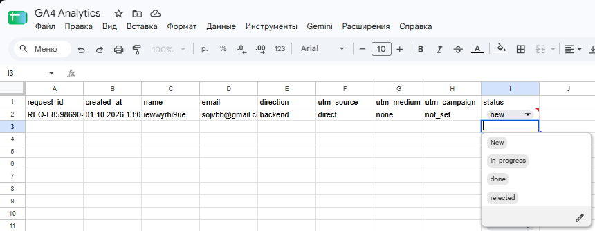
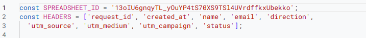
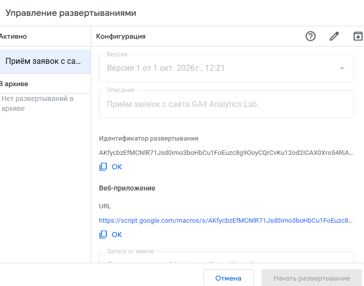
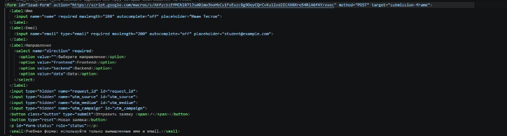
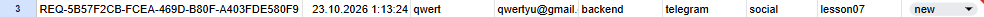
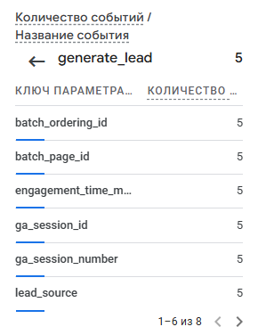
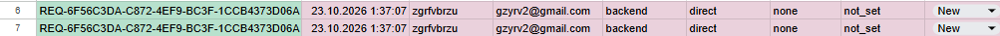
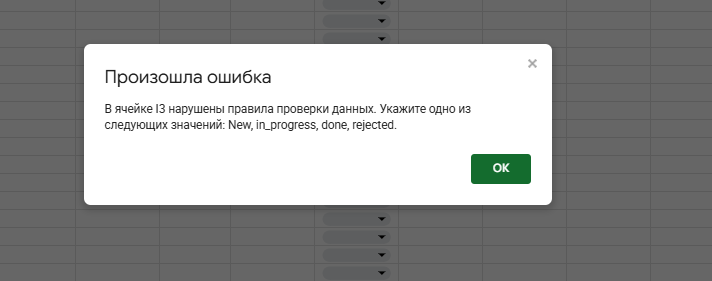

# Домашняя работа № 5 · Контролируемая таблица заявок

**Дисциплина:** ОП.03 «Информационные технологии»

| Поле | Значение |
|---|---|
| Фамилия, имя, отчество | Константинов Валерий Владимирович |
| Группа | РПО 25/9/3 |
| Номер работы | 5 |
| Тема работы | Форма сайта → Apps Script → Google Таблица заявок |
| Дата сдачи | 23.10.2026 |

---

## 1. Таблица

Я создал таблицу «GA4 Analytics Lab — Leads» с листом `leads`. В первой
строке девять заголовков: `request_id`, `created_at`, `name`, `email`,
`direction`, `utm_source`, `utm_medium`, `utm_campaign`, `status`. Строка
заголовков закреплена, у статуса список из четырёх значений: `new`,
`in_progress`, `done`, `rejected`. Два правила подсвечивают неполную строку
и повторный `request_id`.

Ссылка на таблицу (доступ открыт только преподавателю): https://docs.google.com/spreadsheets/d/13oIU6gnqyTL_yOuYP4tS70XS9TSl4UVrdffkxUbekko/edit

## 2. Приёмник и форма

Я вставил `Code.gs` из материалов в Apps Script, указал ID своей таблицы
и опубликовал проект как Web app. Форму в `contacts.html` заменил
фрагментом из материалов, в `action` поставил адрес своего Web app,
обработчик формы в `js/script.js` заменил новым.

| Мои данные | Значение |
|---|---|
| Публичный адрес сайта | https://web-project-ga.vercel.app/ |
| Measurement ID (`G-…`) | G-T6JJ39J1J9 |
| Коммит с новой формой (первые 7 символов) | 4f8d224 |

## 3. Две тестовые заявки

Первую заявку я отправил со страницы без меток: в таблице записалось
`direct` / `none` / `not_set` и статус `new`. Вторую отправил по ссылке
с метками `telegram` / `social` / `lesson07`, и они записались в свои
столбцы.

Ссылка второй заявки: https://web-project-ga.vercel.app/contacts.html?utm_source=telegram&utm_medium=social&utm_campaign=lesson07

| | Заявка без меток | Заявка с метками |
|---|---|---|
| `request_id` | REQ-6F56C3DA-C872-4EF9-BC3F-1CCB4373D06A | REQ-5B57F2CB-FCEA-469D-B80F-A403FDE580F9 |

## 4. Событие в аналитике

После отправки в GA4 пришло событие `generate_lead`. Оно показывает
попытку отправки формы, а сама заявка подтверждается строкой в таблице.

## 5. Проверки

Форма с пустым именем не отправилась. Повторная отправка без кнопки
«Новая заявка» не добавила строку. Копия строки с тем же `request_id`
подсветилась, после кадра я её удалил. Статус `finished` таблица
не приняла, а через список статус сменился `new` → `in_progress` → `done`.

---

Не получилось (если всё работает, оставьте пустым): ___

ИИ: использовал для заполнения бланка и списка кадров
