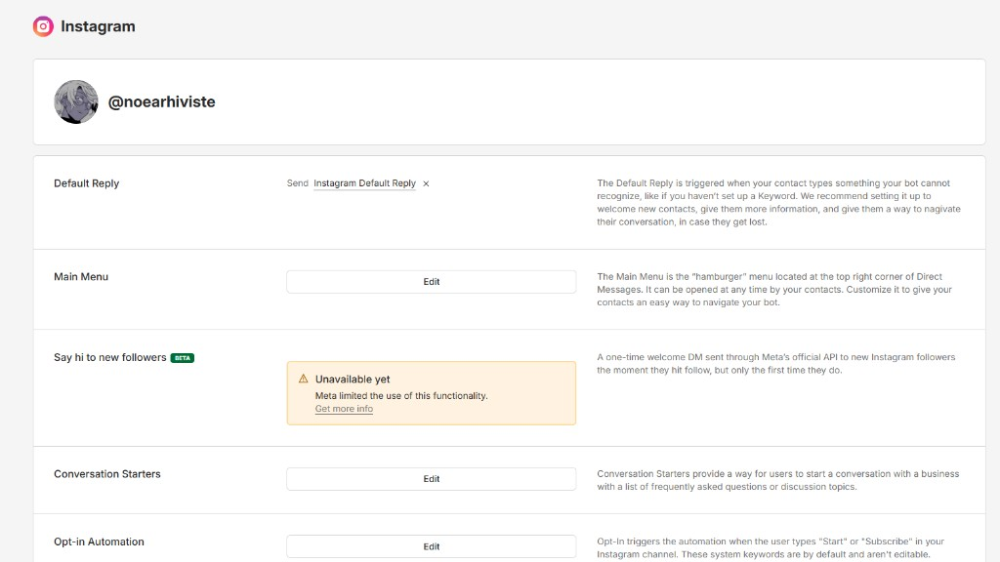
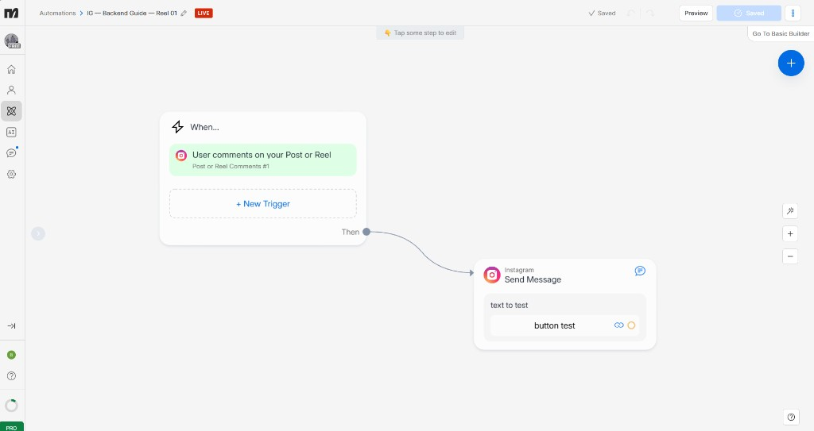
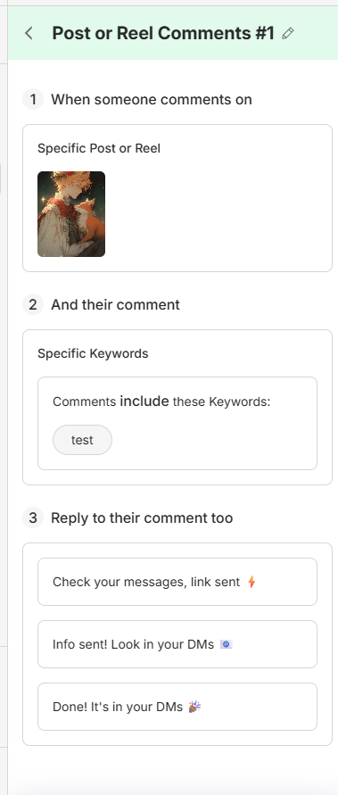
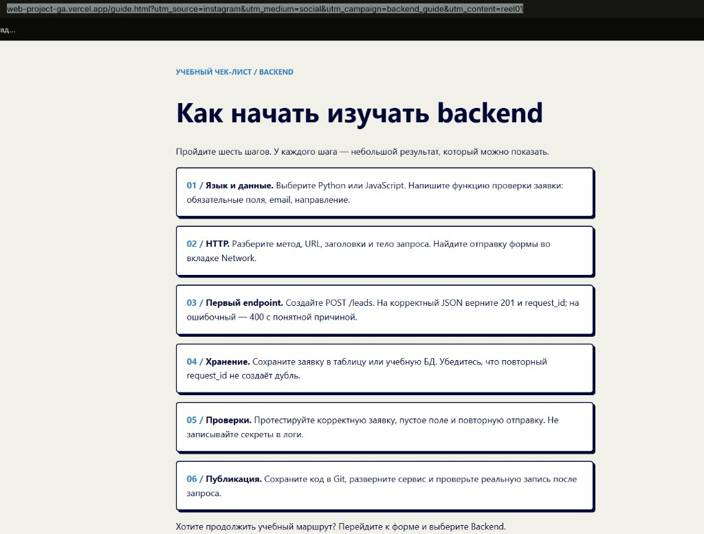
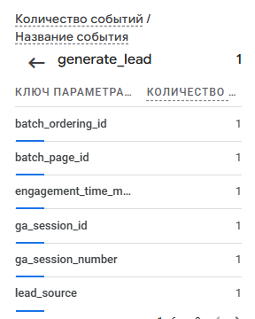
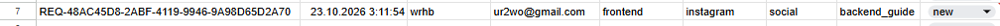

# Домашняя работа № 7 · Instagram → ManyChat → заявка

**Дисциплина:** ОП.03 «Информационные технологии»

| Поле | Значение |
|---|---|
| Фамилия, имя, отчество | Константинов Валерий Владимирович |
| Группа | РПО 25/9/3 |
| Номер работы | 7 |
| Тема работы | Автоворонка из Instagram: комментарий → сообщение → сайт → заявка |
| Дата сдачи | 23.10.2026 |

---

## 1. Подключение и automation

Я перевёл учебный аккаунт Instagram в профессиональный и подключил его
к ManyChat на тарифе Free. Собрал automation: триггер на комментарий под
выбранной публикацией, ключевое слово `ГАЙД`, публичный ответ, личное
сообщение и кнопка «Получить материал» со ссылкой с UTM. Automation
включена в режиме Live.

| Мои данные | Значение |
|---|---|
| Учебный аккаунт Instagram | @noearhiviste |
| Ссылка на учебную публикацию | https://www.instagram.com/p/DegnENACL6v/ |
| Публичный адрес сайта | https://web-project-ga.vercel.app/ |
| Measurement ID (`G-…`) | G-T6JJ39J1J9 |

Ссылка в кнопке ManyChat: https://web-project-ga.vercel.app/guide.html?utm_source=instagram&utm_medium=social&utm_campaign=backend_guide&utm_content=reel01

## 2. Тест цепочки

Второго аккаунта Instagram нет, поэтому комментарий и сообщение в Direct
не проверялись. Страницу `guide.html` с метками открыл по ссылке из кнопки,
оттуда перешёл к форме и отправил тестовую заявку.

## 3. Результат

В GA4 пришли `page_view` со страницы `guide.html` и `generate_lead`.
В листе `leads` появилась строка с метками `instagram` / `social` /
`backend_guide` и статусом `new`.

`request_id` заявки: REQ-48AC45D8-2ABF-4119-9946-9A98D65D2A70

---

Не получилось (если всё работает, оставьте пустым): нет второго аккаунта Instagram, кадры комментария и Direct не сняты.

ИИ: использовал для заполнения бланка и списка кадров
